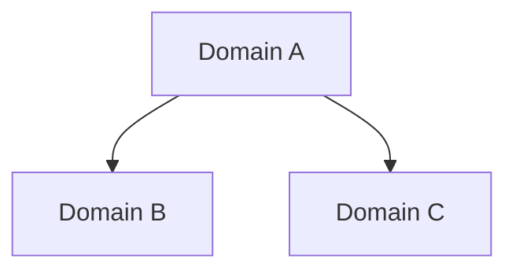

# wiki-lint: Wiki Health Check

Run lint after every 10-15 ingests, or weekly. Ask before auto-fixing anything. Output a lint report to `wiki/meta/lint-report-YYYY-MM-DD.md`.

---

## Deterministic engine first, judgment second

Before applying judgment-based checks, run the deterministic aggregator. It
runs the nine checks that ship with this skill — dead links, orphans,
frontmatter gaps, contradictions, typed relations, citations, stale citations,
tag vocabulary and misplaced pages — and reports per-check status
(`pass` / `fail` / `error`). `--json` prints `{"results": [...], "pages": N}`.
A check that cannot run is `error`, not `skip`, and `error` fails the exit code:

```bash
# Default: writes wiki/meta/lint-report-YYYY-MM-DD.md and prints a summary
python3 .agents/skills/wiki-lint/scripts/run-lint.py

# JSON only (for pipelines / dashboards):
python3 .agents/skills/wiki-lint/scripts/run-lint.py --json
```

The aggregator resolves the vault root by walking up from the working directory
(then from the script's own location) for a directory with `wiki/` and `.git`,
where `wiki/` is not a skill directory (no `wiki/SKILL.md`). Run it from inside
the vault. The deterministic pass is the **engine** for everything below — only
apply judgment checks (stale claims, missing cross-refs, semantic duplication)
on top of its output, never as a replacement.

---

## Lint Checks

Work through these in order:

1. **Orphan pages**. Wiki pages with no inbound wikilinks. They exist but nothing points to them.
2. **Dead links**. Wikilinks that reference a page that does not exist.
3. **Stale claims**. Assertions on older pages that newer sources have contradicted or updated.
4. **Missing pages**. Concepts or entities mentioned in multiple pages but lacking their own page.
5. **Missing cross-references**. Entities mentioned in a page but not linked.
6. **Frontmatter gaps**. Pages missing required fields (type, status, created, updated, tags).
7. **Empty sections**. Headings with no content underneath.
8. **Stale index entries**. Items in `wiki/index.md` pointing to renamed or deleted pages.
9. **Address validity** (DragonScale Mechanism 2). For every page that has an `address:` frontmatter field, validate the format. See `references/opt-in-checks.md` (§ Address Validation).
10. **Semantic tiling** (DragonScale Mechanism 3, opt-in). Flag candidate duplicate pages (across all scanned types, not just concepts) via embedding cosine similarity. See `references/opt-in-checks.md` (§ Semantic Tiling).
11. **Title overlap** (lightweight duplicate pre-filter). Pages whose filename tokens overlap above a Jaccard threshold (`scripts/lint-title-overlap.py`). See `references/opt-in-checks.md` (§ Title Overlap).
12. **Bilingual terminology checks** (opt-in). Deterministic and judgment-based checks on DNT-classified pages. See `references/opt-in-checks.md` (§ Bilingual Terminology Checks).
13. **Typed relations** (deterministic). Dangling relation targets, unknown relation types, and self-relations in `relations:` frontmatter (`scripts/lint-relations.py`, aggregated into `run-lint.py`). The same script answers graph queries outside the gate: `graph [PAGE]` for adjacency, `reverse PAGE` for typed backlinks.
14. **Tag vocabulary** (deterministic, opt-in). Page tags outside the fixed vocabulary in kb-config.yaml `tags.allowed` (`scripts/lint-tag-taxonomy.py`, aggregated into `run-lint.py`). Off-vocabulary tags whose normalized form (accents/separators/singular) matches exactly one allowed tag get an actionable hint ("use X or add tags.aliases"); `tags.aliases` maps known variants to canonical tags and passes. Every run refreshes the derived registry `.cache/tag-registry.json` (counts, first/last seen, status); `--survey` prints the live inventory and near-duplicate clusters for curation. Skips with exit 0 when no vocabulary is configured; case-insensitive unless `tags.case_sensitive: true`. Use it to stop drift like `flujo`/`flujos`, `kick-off`/`kickoff` or `diseño`/`diseno` (all observed in vulcano-kb before this check).
15. **Misplaced pages** (deterministic, opt-in). Page frontmatter `type:` must be allowed in the page's top-level folder per kb-config.yaml `layout.type_folders` mapping (`scripts/lint-misplaced-pages.py`, aggregated into `run-lint.py`). Exempts `meta/`, `.reciclaje/`, root pages, `_index.md` and the state file names. `layout.require_type: true` (default) also flags non-exempt pages with no `type:`. Skips with exit 0 when no mapping is configured. Catches pages living in the wrong folder, like a `type: source` in `concepts/` or a `type: concept` in `decisiones/` (both observed in real vaults).
16. **Source citations** (deterministic, error-gated). Validates `^[source]`, `^[source:L1-L2]` and `^[source#L1-L2]` markers in wiki pages (`scripts/lint-citations.py`, aggregated into `run-lint.py`). Errors: cited file missing, malformed marker, reversed or zero-start range. Warnings: range past end of file. Markers inside fenced code are ignored. Cited paths are relative to the vault root, normally under `.raw/`. A citation metrics report (coverage stats over the same markers; not a gate) is available via `scripts/citation-metrics.py`.
17. **Stale citations** (deterministic, error-gated). A cited source file changed on disk after ingest — its current hash no longer matches the hash recorded in `.raw/.manifest.json` — or the cited file was never ingested (absent from the manifest) (`scripts/lint-stale-citations.py`, aggregated into `run-lint.py`). Re-run the ingest for any flagged source, then re-validate the citations that point at it.

---

## Lint Report Format

Create at `wiki/meta/lint-report-YYYY-MM-DD.md`:

```markdown
---
type: meta
title: "Lint Report YYYY-MM-DD"
created: YYYY-MM-DD
updated: YYYY-MM-DD
tags: [meta, lint]
status: developing
---

# Lint Report: YYYY-MM-DD

## Summary
- Pages scanned: N
- Issues found: N
- Auto-fixed: N
- Needs review: N

## Orphan Pages
- [[Page Name]]: no inbound links. Suggest: link from [[Related Page]] or delete.

## Dead Links
- [[Missing Page]]: referenced in [[Source Page]] but does not exist. Suggest: create stub or remove link.

## Missing Pages
- "concept name": mentioned in [[Page A]], [[Page B]], [[Page C]]. Suggest: create a concept page.

## Frontmatter Gaps
- [[Page Name]]: missing fields: status, tags

## Stale Claims
- [[Page Name]]: claim "X" may conflict with newer source [[Newer Source]].

## Cross-Reference Gaps
- [[Entity Name]] mentioned in [[Page A]] without a wikilink.
```

---

## Naming Conventions

Enforce these during lint:

| Element | Convention | Example |
|---------|-----------|---------|
| Filenames | Title Case with spaces | `Machine Learning.md` |
| Folders | lowercase with dashes | `wiki/data-models/` |
| Tags | lowercase, hierarchical | `#domain/architecture` |
| Wikilinks | match filename exactly | `[[Machine Learning]]` |

Filenames must be unique across the vault. Wikilinks work without paths only if filenames are unique.

---

## Writing Style Check

During lint, flag pages that violate the style guide:

- Not declarative present tense ("X basically does Y" instead of "X does Y")
- Missing source citations where claims are made
- Uncertainty not flagged with `> [!gap]`
- Contradictions not flagged with `> [!contradiction]`

---

## Lint-health dashboard

Create or update `wiki/meta/dashboard.md` as **plain Markdown** — this vault is
read by agents and by GitHub/GitLab wikis, not by Obsidian plugins, so a
Dataview query block renders as inert text. Regenerate the tables from the
current lint output each run; they are a snapshot, not a live view.

```markdown
---
type: meta
title: "Lint health dashboard"
created: YYYY-MM-DD
updated: YYYY-MM-DD
tags:
  - meta
  - lint
status: developing
---

# Wiki lint health

Counts come from `run-lint.py --json` for this run.

| Check | Status | Findings |
|---|---|---|
| Dead links | pass/fail/error | N |
| Orphans | pass/fail/error | N |
| Frontmatter gaps | pass/fail/error | N |
| Typed relations | pass/fail/error | N |
| Citations | pass/fail/error | N |
| Stale citations | pass/fail/error | N |
| Tag vocabulary | pass/fail/skipped | N |
| Misplaced pages | pass/fail/skipped | N |

## Pages needing development

| Page | Status | Updated |
|---|---|---|
| [[…]] | seed | YYYY-MM-DD |

## Open questions

| Page | Answer quality | Created |
|---|---|---|
| [[…]] | draft | YYYY-MM-DD |
```

`wiki/dashboard.md` (project progress against `wiki/goals.md`) is a different
file with a different owner — see `kb-setup/assets/project-agents-block.md`.
Do not merge the two.

---

## Domain Map

Create or update `wiki/meta/overview.md` with a visual domain map using Mermaid:



Add one node per domain page. Connect domains that have significant cross-references.

---

## Opt-in checks — load the reference, do not guess

Four checks are opt-in and depend on companion scripts that do **not** ship with
this skill: Address Validation (DragonScale), Semantic Tiling, Title Overlap and
Bilingual Terminology.

**MANDATORY**: before running any of them, read
[`references/opt-in-checks.md`](references/opt-in-checks.md) in full — it holds
the classification rules, thresholds, exit codes and report shapes.

**Do NOT load** it when the vault uses none of these features: the default lint
path is `run-lint.py` plus the judgment checks above, and loading 260 lines of
inactive policy dilutes them.

Trigger map:

| Condition in the vault | Section to run |
|---|---|
| `address:` frontmatter, or `scripts/allocate-address.py` + `.cache/address-counter.txt` | Address Validation |
| embeddings configured, or the user asks for duplicate detection beyond names | Semantic Tiling + Title Overlap |
| `AGENTS.md`/`CLAUDE.md` references a bilingual-terminology policy | Bilingual Terminology |

A missing companion script is reported as `not available`, never as a pass.

---


## Before Auto-Fixing

Always show the lint report first. Ask: "Should I fix these automatically, or do you want to review each one?"

Safe to auto-fix:
- Adding missing frontmatter fields with placeholder values
- Creating stub pages for missing entities
- Adding wikilinks for unlinked mentions

Needs review before fixing:
- Deleting orphan pages (they might be intentionally isolated)
- Resolving contradictions (requires human judgment)
- Merging duplicate pages
